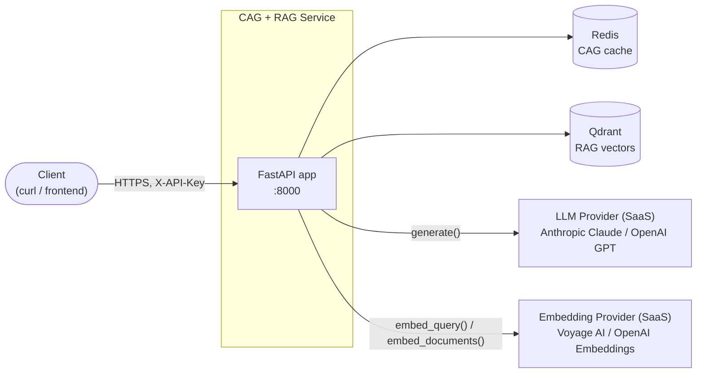
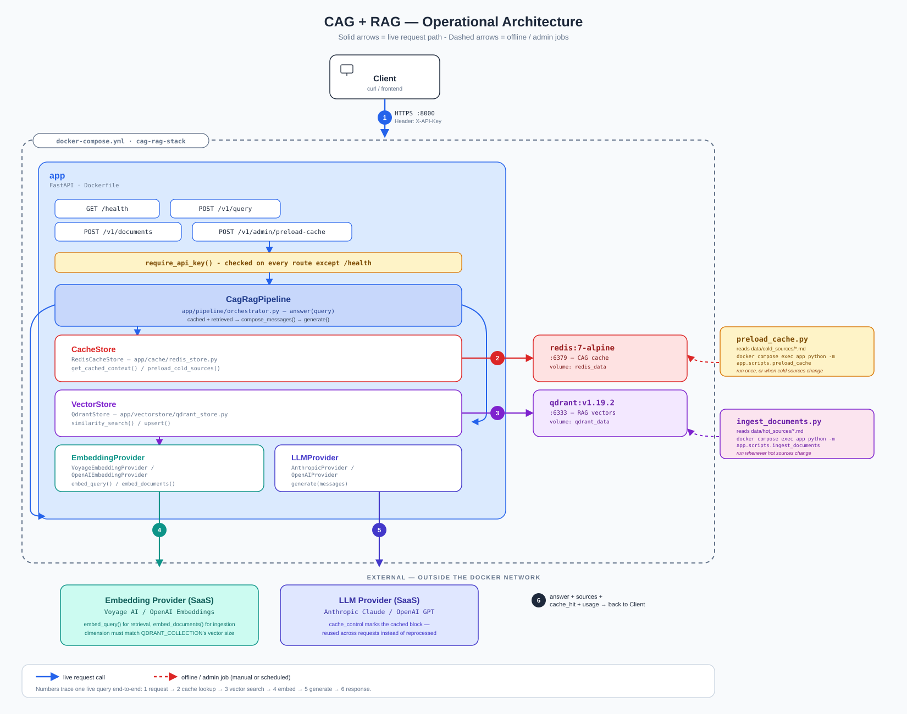
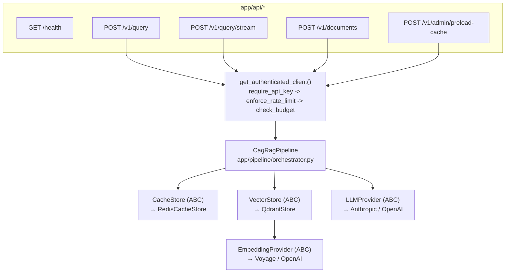
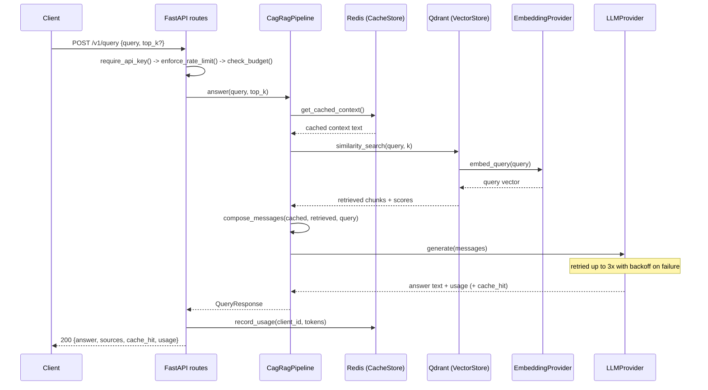
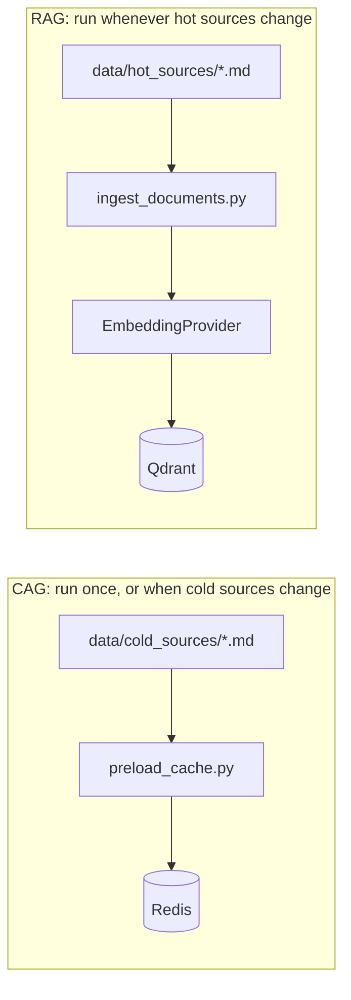
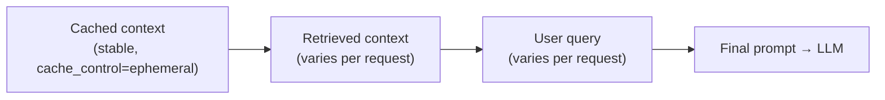
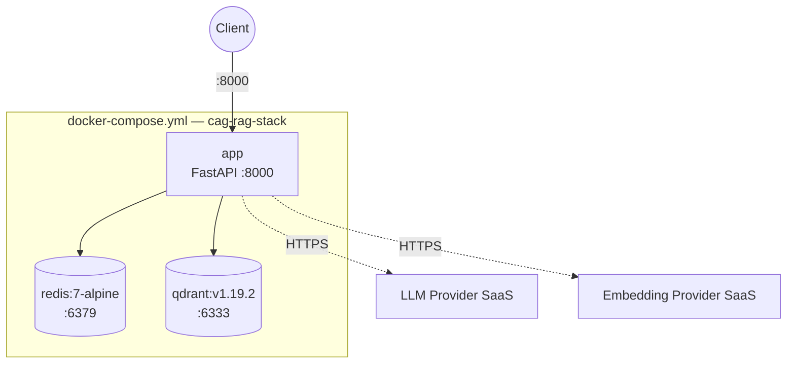

# Architecture Design Document — CAG + RAG Reference Service

| | |
|---|---|
| **Status** | Accepted |
| **Owner** | Kamal Pandey |
| **Scope** | `cag-rag-reference-architecture` (this repository) |
| **Last updated** | 2026-10-20 |

## Table of Contents

1. [Summary](#1-summary)
2. [Goals and Non-Goals](#2-goals-and-non-goals)
3. [Problem Statement](#3-problem-statement)
4. [System Context](#4-system-context)
5. [Architecture Overview](#5-architecture-overview)
6. [Component Design](#6-component-design)
7. [Request Lifecycle](#7-request-lifecycle)
8. [Offline Data Pipelines](#8-offline-data-pipelines)
9. [Caching Strategy](#9-caching-strategy)
10. [Data & API Contracts](#10-data--api-contracts)
11. [Deployment View](#11-deployment-view)
12. [Security Model](#12-security-model)
13. [Reliability & Failure Modes](#13-reliability--failure-modes)
14. [Scalability Considerations](#14-scalability-considerations)
15. [Design Alternatives Considered](#15-design-alternatives-considered)
16. [Testing Strategy](#16-testing-strategy)
17. [Open Questions & Future Work](#17-open-questions--future-work)
18. [References](#18-references)

---

## 1. Summary

This service answers a query by combining two different ways of giving an
LLM context: **Cache Augmented Generation (CAG)**, which preloads stable,
rarely-changing knowledge once, and **Retrieval Augmented Generation
(RAG)**, which searches live, frequently-changing knowledge on every
request. Both are merged into a single prompt that an LLM provider turns
into a grounded answer.

The system is a single FastAPI service backed by Redis (the CAG cache) and
Qdrant (the RAG vector store), with the LLM and embedding calls routed
through provider-agnostic interfaces so the generation and embedding
vendors can be swapped without touching application logic.

## 2. Goals and Non-Goals

**Goals**

- Serve answers that combine durable, curated knowledge with fresh,
  frequently-changing knowledge, in one prompt.
- Make the cold (CAG) and hot (RAG) paths operationally independent: the
  cache can be rebuilt without touching the vector store, and vice versa.
- Keep the LLM and embedding vendor swappable behind a narrow interface —
  no code outside `app/llm/` and `app/embeddings/` should know which
  vendor is active.
- Get real benefit from LLM provider-side prompt caching (not just an
  internal Redis cache) by controlling prompt structure and ordering.
- Be runnable and testable without any cloud credentials (fakes for every
  external dependency).

**Non-Goals**

- Per-tenant *data* isolation (each API key is rate-limited and
  budget-tracked independently, but all keys share one cache namespace and
  one Qdrant collection — see [§12](#12-security-model)).
- A document-management UI, versioning, or deletion workflow for the
  vector store beyond upsert.
- High-availability Redis/Qdrant topologies (single-node Compose setup).
- Prompt-injection or jailbreak defenses beyond a scoped system prompt.
- Pre-flight cost estimation: budget enforcement is based on usage already
  recorded from earlier calls, not a prediction of the call about to be
  made (token count isn't known until generation completes).

## 3. Problem Statement

A pure RAG system pays an embedding + vector-search + full-prompt-reprocessing
cost on *every single request*, even for facts that never change — a
company handbook, a warranty policy. A pure CAG system (everything
preloaded once) goes stale the moment anything changes, and can't answer
questions about today's data.

Neither technique alone is sufficient for a system that needs both a
stable knowledge baseline and live facts. This service treats them as two
complementary paths into the same context window rather than competing
architectures, and is deliberately built to make that combination — not
just RAG, and not just CAG — the thing under test.

## 4. System Context



The service owns Redis and Qdrant (both run alongside it in Docker
Compose); the LLM and embedding providers are external SaaS dependencies
reached over the internet.

## 5. Architecture Overview



The diagram above is the deployment-level view: the live request path
(solid arrows, numbered 1–6) through auth, the pipeline, Redis, Qdrant and
the two external providers; and the offline/admin path (dashed arrows) run
via the two CLI scripts, outside the request path entirely.

## 6. Component Design



| Component | File | Responsibility |
|---|---|---|
| Routers | `app/api/routes_*.py` | HTTP surface; thin, no business logic |
| `require_api_key` | `app/core/security.py` | Resolves `X-API-Key` to a `ClientContext(client_id, api_key)` |
| `enforce_rate_limit` | `app/core/rate_limit.py` | Fixed-window request cap per client_id, backed by `CacheStore.incr` |
| `check_budget` / `record_usage` | `app/core/budget.py` | Daily token cap per client_id, same cache-backed counter pattern |
| `CagRagPipeline` | `app/pipeline/orchestrator.py` | The one place that sequences cache lookup → retrieval → compose → generate (or stream) |
| `CacheStore` | `app/cache/base.py`, `redis_store.py` | Durable store for the cold-context block **and** the rate-limit/budget counters |
| `VectorStore` | `app/vectorstore/base.py`, `qdrant_store.py` | Live similarity search + upsert over hot documents |
| `EmbeddingProvider` | `app/embeddings/base.py`, `voyage_provider.py`, `openai_provider.py` | Turns text into vectors, for both ingestion and query time |
| `LLMProvider` | `app/llm/base.py`, `anthropic_provider.py`, `openai_provider.py` | Generation (complete or streamed); owns provider-specific prompt-caching mechanics |

`CacheStore` doing double duty — cold-context storage *and* rate-limit/budget
counters — is deliberate, not incidental: both are "a small piece of state
that must survive a restart and doesn't need a dedicated datastore," and
Redis's atomic `INCRBY` is exactly the primitive counters need.

Every arrow in the diagram above is an interface, not a concrete class —
`CagRagPipeline` is constructed with whatever `CacheStore`/`VectorStore`/
`LLMProvider` implementation `app/api/deps.py` wires up from `Settings`.
Tests substitute `tests/fakes.py` implementations at exactly this seam.

## 7. Request Lifecycle



If `get_cached_context()` finds nothing (the cache was never preloaded),
`CacheNotPreloadedError` short-circuits the request with `409 Conflict`
before any embedding or generation call is made — a configuration error,
not a transient failure, should fail fast and cheaply. A failed auth,
rate-limit, or budget check short-circuits even earlier, before `answer()`
is ever called.

`POST /v1/query/stream` follows the same `_prepare()` path (cache lookup,
retrieval, compose) and then calls `llm_provider.stream()` instead of
`generate()`, emitting Server-Sent Events (`sources` → `token`\* → `done`).
It is not wrapped in the retry policy (restarting mid-stream would
duplicate output the client already received) and does not call
`record_usage()` (providers only report token usage once a stream
completes — see the docstring on `routes_query.query_stream`).

## 8. Offline Data Pipelines

The cold (CAG) and hot (RAG) paths are populated by two independent CLI
jobs, never by the request path itself:



`preload_cache.py` reads every `.md`/`.txt` file under `COLD_SOURCE_DIR`,
concatenates them into one block (truncated to `CACHED_CONTEXT_MAX_TOKENS`
if needed), hashes it, and stores it as JSON in Redis — idempotent, so
re-running it is always safe. `ingest_documents.py` chunks every file under
a hot-source directory (`RecursiveCharacterTextSplitter`) and upserts the
chunks into Qdrant; `POST /v1/documents` does the same thing per-request
for programmatic ingestion.

## 9. Caching Strategy

Redis is **not** what makes generation cheaper — it only makes the
assembled cold-context text survive a restart. The actual latency/cost win
comes from the LLM provider's own prompt cache, and getting it requires
controlling prompt structure:

- **Anthropic**: `AnthropicProvider` marks the cached-context block with
  `cache_control: {"type": "ephemeral"}`. Anthropic reuses the KV-cache
  for that exact prefix across requests — billed and reprocessed once per
  cache TTL instead of on every query.
- **OpenAI**: no explicit opt-in exists; OpenAI automatically caches
  identical prompt prefixes of 1024+ tokens. `OpenAIProvider` gets the same
  effect for free by preserving the same ordering.

This is why `app/pipeline/composer.py` is strict about prompt structure:
**the cached block must be byte-identical across requests and must come
before anything that varies per request.** Retrieved documents and the
user's question always come after it, never inside it.



## 10. Data & API Contracts

**Cache key**: `{CACHE_KEY_PREFIX}:{CACHE_KEY_VERSION}` (default
`cag:cached_context:v1`) → JSON `{text, hash, files}`. Bumping
`CACHE_KEY_VERSION` is the escape hatch for a breaking change to the
assembled format without deleting the old key.

**Qdrant collection**: one collection (`QDRANT_COLLECTION`), cosine
distance, vector size fixed to `EMBEDDING_DIM` — which **must** match
whatever embedding model is actually configured. `VALIDATE_EMBEDDING_DIM`
(default `true`) checks this once per process, at `QdrantStore`
construction, with one real embedding call
(`validate_embedding_dimension()` in `app/vectorstore/qdrant_store.py`),
and raises a clear `ConfigurationError` naming the mismatch instead of
letting every insert fail later with a terser Qdrant error.

**`POST /v1/query`**

```json
// request
{ "query": "How many PTO days do I get?", "top_k": 4 }
// response
{
  "answer": "...",
  "sources": [{ "id": "...", "text": "...", "score": 0.91, "metadata": {} }],
  "cache_hit": true,
  "usage": { "input_tokens": 812, "output_tokens": 64, "cache_read_input_tokens": 640 }
}
```

**`POST /v1/documents`** — `{"documents": [{"text": "...", "metadata"?: {}}]}`
→ `{"ingested": <chunk count>}`.

**`POST /v1/admin/preload-cache`** — no body →
`{"cached_chars": ..., "source_files": [...], "content_hash": "..."}`.

Full schemas: `app/schemas/models.py`.

## 11. Deployment View



Single Compose stack, three services, two named volumes
(`redis_data`, `qdrant_data`) for persistence across restarts. The app
image is built from the repo's `Dockerfile`; `preload_cache.py` and
`ingest_documents.py` are run via `docker compose exec app python -m ...`
rather than as containers of their own.

## 12. Security Model

- Every route but `/health` requires `X-API-Key`, resolved by
  `require_api_key()` (`app/core/security.py`) to a `ClientContext`.
  `API_KEY` is the legacy single key (client_id `default`); `API_KEYS`
  (`"key1:alice,key2:bob"`) adds named callers, each tracked independently.
  Unknown keys get a uniform `401` — the key→client_id map is never
  revealed by the error.
- **Rate limiting** (`app/core/rate_limit.py`): a fixed-window counter —
  `RATE_LIMIT_PER_MINUTE` requests per client_id per 60s window, stored as
  `ratelimit:{client_id}:{window}` in the cache store. Simple on purpose; a
  sliding window or token bucket would smooth window-boundary bursts
  better, at the cost of more cache operations per request — not worth it
  for a reference service.
- **Budget guardrail** (`app/core/budget.py`): `MAX_DAILY_TOKENS_PER_CLIENT`
  caps total input+output tokens per client_id per day
  (`budget:{client_id}:{date}`). This is enforced *before* a request based
  on usage already recorded from earlier ones — it cannot know the cost of
  the request about to be made, since token count isn't known until
  generation completes (see [§2 Non-Goals](#2-goals-and-non-goals)).
- The auth chain order is deliberate: `require_api_key` → `enforce_rate_limit`
  → `check_budget` (`get_authenticated_client` in `app/api/deps.py`), so an
  unknown key never consumes a rate-limit slot, and a rate-limited caller
  never reaches the budget check.
- Provider API keys (`ANTHROPIC_API_KEY`, `VOYAGE_API_KEY`, etc.) live only
  in `.env` (gitignored); `.env.example` ships with every value blank.
- `/health` is intentionally unauthenticated and never throws — see
  [§13](#13-reliability--failure-modes).
- Still out of scope: request signing, per-tenant data isolation (all
  clients share one cache namespace and one Qdrant collection), and
  prompt-injection defenses beyond the scoped system prompt in
  `composer.py`.

## 13. Reliability & Failure Modes

| Failure | Behavior | Why |
|---|---|---|
| Cache never preloaded | `POST /v1/query` → `409` before any provider call | `CacheNotPreloadedError`; a config error, not transient |
| Redis unreachable | `GET /health` reports `redis_ok: false`, no 500 | Checks are isolated per-dependency in the handler body, not resolved as `Depends()` (which would raise before the handler runs) |
| Qdrant unreachable | Same as above for `vector_store_ok` | Same isolation pattern |
| Missing provider API key | Raised only when that provider is actually constructed (first real use), not at process startup | Keeps `/health` and unrelated routes usable even if one provider is unconfigured |
| `EMBEDDING_DIM` mismatch | `ConfigurationError` (`500`) at startup, naming the actual vs. expected dimension | Fails once, clearly, instead of every insert failing later with a terser Qdrant error |
| LLM/embedding transient error (timeout, 5xx, rate limit from the *provider*) | Retried up to 3x with exponential backoff + jitter (`app/core/retry.py`), then propagates | Broad policy on purpose — vendor SDKs raise different exception types; see [§17](#17-open-questions--future-work) for the tradeoff this accepts |
| Caller exceeds `RATE_LIMIT_PER_MINUTE` | `429` before the pipeline runs | `RateLimitExceededError`; cheap to check, so checked first |
| Caller exceeds `MAX_DAILY_TOKENS_PER_CLIENT` | `429` before the pipeline runs | `BudgetExceededError`; checked after rate limit, before any provider call |

## 14. Scalability Considerations

- The app is stateless per request (all state lives in Redis/Qdrant), so
  it scales horizontally by running more `app` containers behind a load
  balancer with no code changes.
- Redis and Qdrant are each single-node in this reference setup; the cache
  is small (one text blob) and would need Redis Cluster/Sentinel only for
  HA, not for size. Qdrant is the component most likely to need real
  scaling (sharding/replication) as the hot document set grows.
- `top_k` and `chunk_size`/`chunk_overlap` are the main levers for
  controlling per-query latency and prompt size as the corpus grows.

## 15. Design Alternatives Considered

| Decision | Alternative | Why rejected |
|---|---|---|
| Two separate stores (Redis + Qdrant) | One vector store holding both cold and hot documents | Mixes two different lifecycles and cost profiles; see `ARCHITECTURE.md` §"Why two separate stores" |
| Provider-agnostic `LLMProvider`/`EmbeddingProvider` interfaces | Call LangChain's chat model classes directly everywhere | Would leak a specific library's abstraction (and its breaking changes) into every call site instead of one factory |
| CLI scripts for preload/ingest | Run preload/ingest automatically on app startup | Makes startup slow and non-idempotent-feeling, and conflates "deploy the service" with "refresh the data" — two different operational events |
| Cache key with explicit version suffix | Unversioned key | Lets the assembled-cache format change without a manual `DEL` in Redis |
| Named API keys (`API_KEYS="key:client_id,..."`) with per-client rate limit + budget | Full OAuth/per-tenant identity provider | Gets independent caller accounting without the operational weight of a real IdP; still no per-tenant *data* isolation — see [§2](#2-goals-and-non-goals) |
| Fixed-window rate limiting | Token bucket / sliding window | Simpler, one cache op per request; accepts window-boundary burst as a known tradeoff |
| Budget check against already-recorded usage | Pre-flight cost estimation before the call | Token count isn't known until generation completes — can't be made exact without a separate pre-call token-counting pass, which isn't implemented |
| Retry inside each provider method, broad `Exception` policy | Per-vendor exception handling (only retry *their* documented transient errors) | Simpler and provider-agnostic at the interface boundary; costs some retries on errors that were never going to succeed (e.g. a bad API key) — see [§17](#17-open-questions--future-work) |

## 16. Testing Strategy

Three layers, each proving something different:

1. **Unit tests against fakes** (`tests/`): `FakeCacheStore`,
   `FakeVectorStore`, `FakeEmbeddingProvider`, `FakeLLMProvider`
   (`tests/fakes.py`). Never call a real API or need Redis/Qdrant running
   — `pytest -v` passes with zero configuration. Covers pipeline logic,
   auth/rate-limit/budget mechanics, dimension validation, and retry
   behavior (`test_retry.py` forces a flaky function to prove the policy
   actually retries and actually reraises after exhausting attempts).
   API-level tests use FastAPI's `dependency_overrides` for `Depends()`
   parameters, and `monkeypatch` on `app.api.deps`/`app.core.security` for
   the plain-function calls inside `get_authenticated_client` and
   `/health` — those aren't the same mechanism, and conflating them is a
   real way to write a test that looks like it covers something it
   doesn't (see the docstring on `_patch_auth` in `tests/test_api.py`).
2. **Integration tests against real Redis + real Qdrant**
   (`tests/integration/`): no mocks, using `FakeEmbeddingProvider` only to
   avoid needing a paid key. Skip themselves if the services aren't
   reachable (so plain `pytest -v` is unaffected), and run for real in
   CI's `integration` job against `redis:7-alpine` and `qdrant/qdrant`
   service containers on every push — see `tests/integration/README.md`.
3. **`scripts/smoke_test.py`**: the one thing nothing above proves — that
   it works with *your* real, paid LLM/embedding keys. Not run in CI (needs
   secrets this repo doesn't have); run by whoever deploys it, against
   their own running stack.

## 17. Open Questions & Future Work

- A real delete/versioning story for hot documents in Qdrant (today only
  upsert exists).
- Observability: structured tracing/metrics, not just `logging`.
- Token-level budget accounting on `/v1/query/stream` — providers only
  report usage once a stream completes, and capturing that cleanly needs a
  provider-level "final chunk" contract this reference doesn't implement.
- Per-vendor exception handling for retries, instead of one broad
  `Exception` policy (see [§15](#15-design-alternatives-considered)).
- Per-tenant *data* isolation (separate cache namespaces / Qdrant
  collections per client_id), if this ever needs to serve genuinely
  mutually-distrusting callers rather than independently-metered ones.

## 18. References

- [`README.md`](../README.md) — quickstart, API table, project layout
- [`ARCHITECTURE.md`](../ARCHITECTURE.md) — shorter companion explainer,
  focused on the CAG/RAG rationale
- [`tests/integration/README.md`](../tests/integration/README.md) — what
  the real-Redis/real-Qdrant tests cover and how to run them
- `scripts/quickstart.sh`, `scripts/smoke_test.py` — one-command local
  setup and the real-keys end-to-end check
- Source of truth for every claim in this document is the code itself,
  under `app/`
